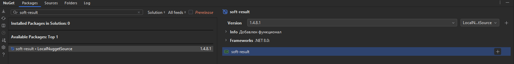

# 🎯 **SoftResult**

[Nugget](https://www.nuget.org/packages/SoftResult)

---

# ⭐ Star This Repository!


## 📋 **Library Information**

- **Type:**          API Library  
- **Framework:**     .NET 10
- **Dependencies:**  _None (lightweight library)_  

---

## ⚙️ **Purpose of the Library**  

SoftResult is a universal library for generating standardized API responses in ASP.NET Core. Its primary goals include:  
- 🔄 Wrapping API responses in `IResult`, derived from `IActionResult`.  
- 📦 Simplifying HTTP response handling in controllers, services, and Mediator.  
- 🔧 Providing a unified API response format for easier client and server interaction.  

---

## 🚀 **Setup Instructions**

1. 🛠️ Ensure that you have the **.NET 8, 9** development environment installed.  
2. Run the following commands to build and publish the package:  

### **🔧 Build the Package**
```shell
dotnet build -c Release
```

### **📦 Create a Local Package Source**
```shell
mkdir /LocalNugget
```

### **📤 Publish the Package to a Local Source**
```shell
dotnet nuget push .\soft-result\bin\Release\soft-result.1.5.10.1.nupkg --source C:\LocalNugget\
```

### **🌐 Publish the Package to a Remote Source**
```shell
dotnet nuget push .\soft-result\bin\Release\soft-result.1.5.10.1.nupkg --api-key YOUR_API_KEY --source https://packages.salyk.kg/nuget
```

### **➕ Add a Local Source to NuGet**
```shell
dotnet nuget add source C:\LocalNugget\ --name LocalNuggetSource
```

### **🔍 View Local Sources**
```shell
dotnet nuget list source
```

### **📥 Add the Package to a Project**
```shell
dotnet add package soft-result --source LocalNuggetSource
```

---

## 🌟 **Key Use Cases**

1. **🔄 Universal API Responses:**  
   All API responses are wrapped in `IResult`, allowing for consistent processing of:  
   - 📝 Message (`Message`),  
   - 📦 Payload (`Value`),  
   - ❗ Errors (`Errors`),  
   - 📋 HTTP Status (`Status`).  

2. **📡 Working with HTTP Requests:**  
   Use the library for generating responses within system components, not just controllers.  

3. **⚙️ Controller Integration:**  
   Unified response mechanism through `IResult:IActionResult`.  

4. **📜 CQRS and MediatR:**  
   Simplify handling in commands and queries by returning `IResult`, making Mediator workflows more seamless.  

5. **🔧 Service Integration:**  
   Service methods return `IResult`, ensuring flexibility in status handling and error messaging.  

---

## 💻 **Example Usage**

### **📜 Query Returning `IResult`**
```csharp
using MediatR;
using WebApi.Application.Interfaces;
using WebApi.Domain.Entities.Dictionary;
using WebApi.SoftResult.Response;
using IResult = WebApi.SoftResult.Interfaces.IResult;

namespace WebApi.Application.Mediatr.Dictionary.SystemType.Queries;

public record GetSystemTypesQuery(
    bool? IsActive = true
) : IRequest<IResult>;

public class GetSystemTypesQueryHandler(
    IApplicationDbContext context
) : IRequestHandler<GetSystemTypesQuery, IResult>
{
    public async Task<IResult> Handle(GetSystemTypesQuery query, CancellationToken cancellationToken)
    {
        var result = context.SystemTypesDictionary.ToList();
        if (query.IsActive is not null)
        {
            result = result.Where(x => x.IsActive == query.IsActive).ToList();
        }

        return result.Any()
            ? Result<List<SystemTypesDictionaryEntity>>.Ok("✅ System list retrieved successfully", result)
            : Result<List<SystemTypesDictionaryEntity>>.NotFound("❌ No systems found");
    }
}
```

### **⚙️ Controller Method Returning `IActionResult`**
```csharp
[HttpGet("get-system-types")]
[Auth([Policies.ForAllPositions])]
public async Task<IActionResult> GetSystemTypes([FromQuery] GetSystemTypesQuery query, CancellationToken cancellationToken)
{
    var result = await Mediator.Send(query, cancellationToken);
    return result;
}
```

### ⚙️ FluentValidator Error Handling In Middleware To `IError`

ValidationFilter.cs
```csharp
public class ValidationFilter : IActionFilter
{
    public void OnActionExecuted(ActionExecutedContext context) { }

    public void OnActionExecuting(ActionExecutingContext context)
    {
        if (context.ModelState.IsValid)
            return;

        var errors = context.ModelState
            .Where(m => m.Value != null && m.Value.Errors.Any())
            .ToDictionary(kvp => kvp.Key, kvp => kvp.Value?.Errors.Select(e => e.ErrorMessage)
            .ToList());

        var result = errors.Select(e =>
        {
            if (e.Value != null)
                return new Dictionary<string, List<string>>
                {
                    { e.Key, e.Value }
                };

            return null;
        });

        context.Result = Result<object>.BadRequest("❌ Validation failed", "📝 ValidationErrors", result);
    }
}
```

ValidatorConfiguration.cs
```csharp
public static class ValidatorConfiguration
{
    public static IServiceCollection AddFluentValidatorConfiguration(this IServiceCollection services)
    {
        services.Configure<ApiBehaviorOptions>(options =>
        {
            options.SuppressModelStateInvalidFilter = true;
        });

        services.AddScoped<ValidationFilter>();
        
        services.AddFluentValidationAutoValidation(options =>
        {
            options.DisableDataAnnotationsValidation = true;

        });

        services.AddFluentValidationClientsideAdapters();
        services.AddValidatorsFromAssembly(Assembly.GetExecutingAssembly());

        return services;
    }
}
```

Program.cs
```csharp
builder.Services.AddControllers(options =>
{
    options.Filters.Add<ValidationFilter>();
});

builder.Services.AddFluentValidatorConfiguration();
```

### **⚙️ `List<IError>` Return Example**

```csharp
var token = await keycloakService.AuthenticateAsync(command.Username, command.Password);
if (token is null)
{
    var error = new Error("Invalid username or password", new Dictionary<string, string>
    {
        { "username", command.Username },
        { "password", command.Password }
    });
    
    return Result<KeycloakTokenResponseDto>.NotFound(error);
}
```

---

**💡 Note:**  
The controller can directly return the result from the `Query` since `IResult` inherits from `IActionResult`.

---

## 📦 **Package Versioning**

- **soft-result: 1.5.10.1**  
  - **1:** Major version.  
  - **5:** Last digit of the year — 2024.  
  - **9:** .NET version.  
  - **1:** Incremental version (increased with each release).  

---

## 🎯 **Why Choose SoftResult?**

- 📋 **Consistent API Responses:** Simplifies client-side processing.  
- 🚀 **Easy Integration:** Works seamlessly with Mediator, controllers, and services.  
- 🔄 **Flexible:** Easily adapts to project-specific requirements.  
- 📜 **Standards Compliant:** Supports RFC 9457 for error descriptions.  

---

## 🌐 **NuGet Package**


---

Try **SoftResult** today to make your API standardized, simple, and efficient! 🎉